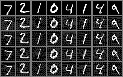

# Adversarial attacks on the MNIST transformer

- Checkpoint: `runs/best.pt`, first 10000 test images
- Threat model: white-box, untargeted, ‖x_adv − x‖∞ ≤ ε on [0, 1] pixels
- **Recognition rate before attacks: 0.9867** (9867 / 10000)
- Attack success rate (ASR): fraction of correctly classified images that the attack misclassifies
- Accuracy under attack: recognition rate × (1 − ASR)

| Attack | Settings |
|---|---|
| FGSM | 1 step |
| I-FGSM | 10 steps, α = ε/10 |
| PGD | 40 steps, α = 2.5ε/40, random start |
| MI-FGSM | 10 steps, α = ε/10, μ = 1.0 |

## Attack success rate

| ε | FGSM | I-FGSM | PGD | MI-FGSM |
|---|---|---|---|---|
| 0.1 | 0.1834 | 0.3228 | 0.5079 | 0.2688 |
| 0.2 | 0.4101 | 0.8033 | 0.9928 | 0.6859 |
| 0.3 | 0.6024 | 0.9614 | 1.0000 | 0.9097 |

## Accuracy under attack

| ε | FGSM | I-FGSM | PGD | MI-FGSM |
|---|---|---|---|---|
| 0.1 | 0.8057 | 0.6682 | 0.4856 | 0.7215 |
| 0.2 | 0.5821 | 0.1941 | 0.0071 | 0.3099 |
| 0.3 | 0.3923 | 0.0381 | 0.0000 | 0.0891 |

## Examples at ε = 0.2

Image rows, top to bottom: clean, FGSM, I-FGSM, PGD, MI-FGSM. Cells are the model's predictions.

| | #1 | #2 | #3 | #4 | #5 | #6 | #7 | #8 |
|---|---|---|---|---|---|---|---|---|
| true label | 7 | 2 | 1 | 0 | 4 | 1 | 4 | 9 |
| clean | 7 | 2 | 1 | 0 | 4 | 1 | 4 | 9 |
| FGSM | 7 | 6 | 8 | 0 | 4 | 1 | 9 | 9 |
| I-FGSM | 5 | 6 | 4 | 7 | 7 | 7 | 9 | 2 |
| PGD | 5 | 6 | 4 | 7 | 9 | 4 | 9 | 4 |
| MI-FGSM | 5 | 6 | 4 | 0 | 7 | 7 | 9 | 9 |
