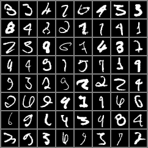

# MNIST test results

- Checkpoint: `runs/best.pt` (epoch 20, val acc 0.9868)
- Model: patch=4, d_model=64, h=4, d_ff=256, n_layers=4, dropout=0.1
- **Test accuracy: 0.9867** (133 errors / 10000)

## Confusion matrix (rows = true, columns = predicted)

| true \ pred | 0 | 1 | 2 | 3 | 4 | 5 | 6 | 7 | 8 | 9 |
|---|---|---|---|---|---|---|---|---|---|---|
| **0** | 974 | 0 | 0 | 0 | 0 | 0 | 4 | 2 | 0 | 0 |
| **1** | 0 | 1126 | 0 | 4 | 0 | 1 | 1 | 2 | 1 | 0 |
| **2** | 3 | 1 | 1014 | 1 | 2 | 0 | 0 | 10 | 1 | 0 |
| **3** | 0 | 0 | 2 | 988 | 0 | 13 | 0 | 0 | 5 | 2 |
| **4** | 0 | 0 | 0 | 0 | 960 | 0 | 4 | 0 | 0 | 18 |
| **5** | 2 | 0 | 0 | 0 | 0 | 887 | 1 | 1 | 1 | 0 |
| **6** | 5 | 1 | 1 | 0 | 1 | 5 | 944 | 0 | 1 | 0 |
| **7** | 1 | 2 | 1 | 0 | 0 | 0 | 0 | 1018 | 1 | 5 |
| **8** | 2 | 0 | 1 | 1 | 0 | 1 | 0 | 0 | 965 | 4 |
| **9** | 1 | 1 | 0 | 0 | 3 | 6 | 0 | 4 | 3 | 991 |

## First 64 misclassified test digits

